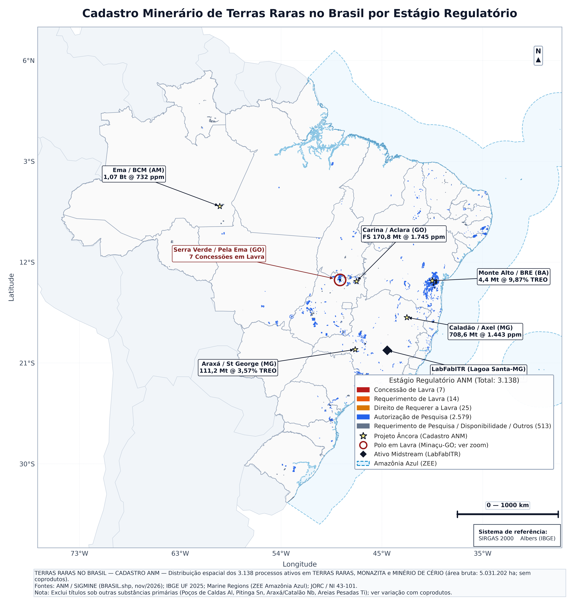
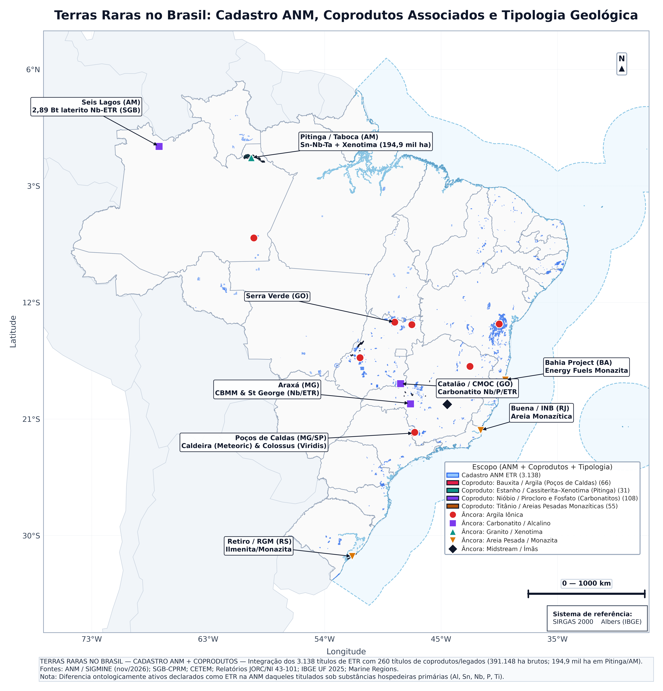
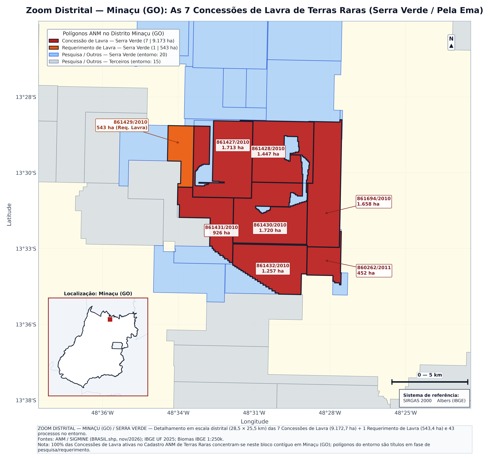
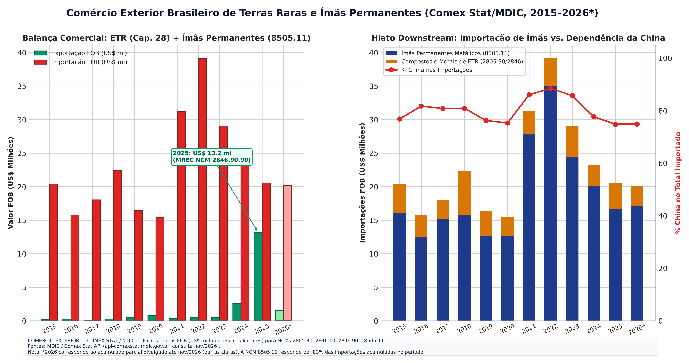

# Terras Raras no Brasil (`terras_raras_brasil`)

[](pyproject.toml)
[](output/figures/png/)
[](NOTICE.md)
[](LICENSE)
[](output/LICENSE)

Geointeligência, cartografia em projeção equivalente **IBGE Albers (`SIRGAS 2000` / `GRS80`)** e análise cadastral/comercial da cadeia de **Terras Raras no Brasil**, integrando o cadastro minerário oficial da **ANM/SIGMINE**, camada segregada de complexos de **coprodutos associados** (Al/Bauxita, Sn/Xenotima, Nb/Fosfato e Ti/Areias Pesadas), projetos âncora JORC/NI 43-101/SGB e séries de comércio exterior do **Comex Stat / MDIC** (`2015–2026*`).

> [!NOTE]
> Este repositório disponibiliza o código-fonte reprodutível (`src/`, `tests/`), o catálogo curado de projetos âncora e ativo midstream ([`anchor_projects_and_midstream.json`](data/curated/anchor_projects_and_midstream.json)) e a seleção publicada das **4 figuras principais a 600 DPI** (`1a`, `1b`, `6b` e `12`). Dados brutos pesados não são versionados no Git e podem ser baixados diretamente das fontes oficiais via `src/fetch_online_sources.py`.

---

## Figuras Publicadas (`600 DPI`, CC BY 4.0)

| Figura | Descrição | Arquivo |
| :---: | :--- | :--- |
| **Fig. 01a** | **Mapa Nacional — Cadastro ANM Estrito (sem coprodutos):** espacialização dos títulos ativos declarados em `TERRAS RARAS`, `MONAZITA` e `MINÉRIO DE CÉRIO`, com estágios regulatórios, projetos âncora, LabFabITR e Amazônia Azul (ZEE). | [`fig_01a_mapa_nacional_etr_estrito_600dpi.png`](output/figures/png/fig_01a_mapa_nacional_etr_estrito_600dpi.png) |
| **Fig. 01b** | **Mapa Nacional — Cadastro ANM + Coprodutos e Tipologia Geológica:** integra o Cadastro ANM aos complexos de coprodutos associados (Poços de Caldas, Pitinga, Araxá/Catalão/Seis Lagos e Areias Pesadas Monazíticas). | [`fig_01b_mapa_nacional_etr_com_coprodutos_600dpi.png`](output/figures/png/fig_01b_mapa_nacional_etr_com_coprodutos_600dpi.png) |
| **Fig. 06b** | **Zoom Distrital — Minaçu (GO):** detalhamento em escala distrital das **7 Concessões de Lavra** e do Requerimento de Lavra da Serra Verde / Pela Ema, com inset localizador em Goiás. | [`fig_06b_zoom_concessoes_lavra_serra_verde_minacu_600dpi.png`](output/figures/png/fig_06b_zoom_concessoes_lavra_serra_verde_minacu_600dpi.png) |
| **Fig. 12** | **Comércio Exterior Brasileiro (Comex Stat/MDIC, 2015–2026\*):** balança comercial anual FOB e dependência de importações de ímãs permanentes metálicos (`NCM 8505.11`) e participação chinesa. | [`fig_12_comercio_exterior_comex_stat_600dpi.png`](output/figures/png/fig_12_comercio_exterior_comex_stat_600dpi.png) |

<p align="center">
  
  
</p>
<p align="center">
  
  
</p>

*(Para o atlas ampliado dos 27 minerais críticos da PNMCE/CIMCE 2026, consulte [`jonathanobr/mince_brasil`](https://github.com/jonathanobr/mince_brasil).)*

---

## Protocolo Metodológico

- **Filtro Anti-Falso-Positivo na ANM (`STRICT_REE_SUBSTANCES`):** filtra exatamente `{"TERRAS RARAS", "MONAZITA", "MINÉRIO DE CÉRIO", "MINERIO DE CERIO"}`, bloqueando falsos positivos de `CITRINO` capturados por buscas amplas por `ITRI`.
- **Segregação Ontológica de Coprodutos:** títulos em que ETR ocorrem em associação a outra substância primária (Poços de Caldas Al/Bauxita, Pitinga Sn/Cassiterita, Araxá/Catalão/Tapira/Seis Lagos Nb/Fosfato e areias pesadas de Ilmenita/Titânio) são processados em camada separada (`anm_coproduct_polygons.parquet`).
- **Comex Stat / MDIC:** consulta os códigos SH6 `280530` (metais de ETR/Sc/Y), `284610` (compostos de cério), `284690` (outros compostos de ETR) e `850511` (ímãs permanentes metálicos / NdFeB).
- **Nota sobre Snapshots Dinâmicos:** as 4 figuras PNG incluídas no repositório retratam o corte oficial de **nov/2026** (`270.994` registros na ANM; `3.138` processos no Cadastro ANM de Terras Raras; `260` títulos em coprodutos; Comex Stat `2015–2025` fechado + `2026*` parcial até nov/2026). Re-execuções futuras com download online refletirão as atualizações vigentes da ANM e do MDIC.

---

## Estrutura do Repositório

```text
.
├── .github/workflows/ci.yml                     # Integração contínua (pytest)
├── data/
│   └── curated/
│       └── anchor_projects_and_midstream.json   # 16 projetos âncora + LabFabITR (MID-01)
├── output/
│   ├── LICENSE                                  # Licença CC BY 4.0 para mapas e figuras
│   └── figures/png/                             # Figuras 01a, 01b, 06b e 12 (600 DPI)
├── src/
│   ├── config.py                                # Constantes geodésicas, paletas, helpers e resolvedores
│   ├── fetch_online_sources.py                  # Download oficial (ANM, IBGE UF, VLIZ ZEE, Natural Earth, Comex Stat)
│   ├── etl_local_sources.py                     # Processamento de basemaps e polígonos ANM + coprodutos
│   ├── build_figures.py                         # Renderização cartográfica e gráfica a 600 DPI
│   └── run_all.py                               # Orquestrador CLI
├── tests/
│   └── test_terras_raras_integrity.py           # Testes automatizados (ontologia, curadoria, figuras e metadados)
├── CITATION.cff                                 # Metadados de citação acadêmica
├── LICENSE                                      # Licença MIT para o código-fonte
├── NOTICE.md                                    # Créditos e termos das fontes públicas
├── pyproject.toml                               # Empacotamento e dependências Python
└── requirements.txt                             # Lista de dependências para pip
```

---

## Instalação e Reprodução

```bash
git clone https://github.com/jonathanobr/terras_raras_brasil.git
cd terras_raras_brasil

python -m venv .venv
# Linux/macOS: source .venv/bin/activate
# Windows PowerShell: .venv\Scripts\Activate.ps1

pip install -r requirements.txt
```

### Baixar fontes oficiais e regenerar as figuras (1a, 1b, 6b, 12)

```bash
# Pipeline completo: baixa ANM/SIGMINE, IBGE UF 2025, VLIZ EEZ, Natural Earth e Comex Stat,
# processa os GeoParquets locais e gera as 4 figuras PNG a 600 DPI:
python src/run_all.py --png-only

# Ou passo a passo:
python src/fetch_online_sources.py
python src/etl_local_sources.py
python src/build_figures.py --figures 01a 01b 06b 12 --png-only

# Executar suíte de testes:
pytest -v
```

---

## Licenciamento e Citação

- **Código-fonte (`src/`, `tests/`):** licenciado sob a **[Licença MIT](LICENSE)**.
- **Mapas e gráficos prontos (`output/figures/png/`):** licenciados sob **[Creative Commons Attribution 4.0 International (CC BY 4.0)](output/LICENSE)**.
- **Fontes primárias de terceiros:** nenhum direito autoral é reivindicado sobre os dados públicos da ANM/SIGMINE, MDIC/Comex Stat, IBGE, Marine Regions/VLIZ (CC BY 4.0) ou Natural Earth (Domínio Público). Consulte [`NOTICE.md`](NOTICE.md) e [`CITATION.cff`](CITATION.cff).

```bibtex
@software{RamosOliveira2026TerrasRarasBrasil,
  author = {Ramos Oliveira, Jonathan},
  title  = {terras\_raras\_brasil: Geointeligência, Cadastro Minerário ANM e Balança Comercial de Terras Raras no Brasil},
  year   = {2026},
  url    = {https://github.com/jonathanobr/terras_raras_brasil},
  note   = {Código sob licença MIT; figuras em output/figures/ sob CC BY 4.0}
}
```
